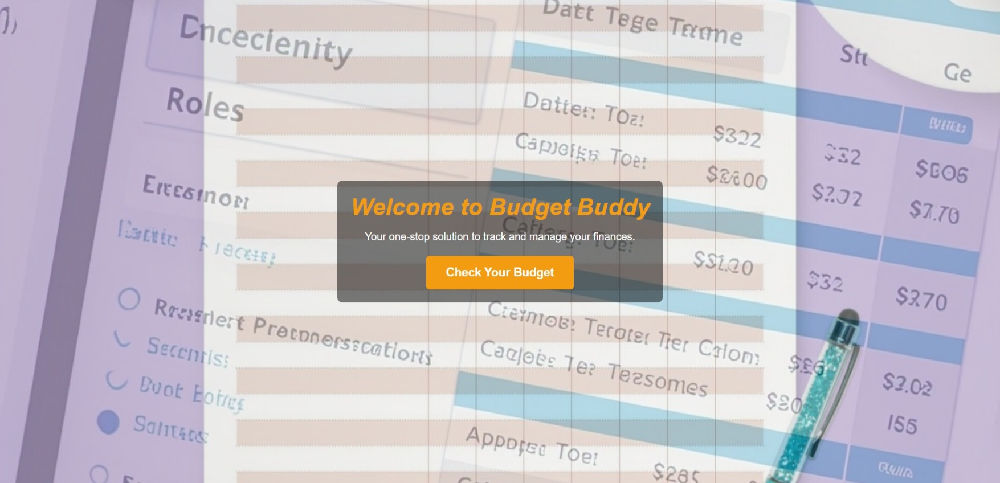
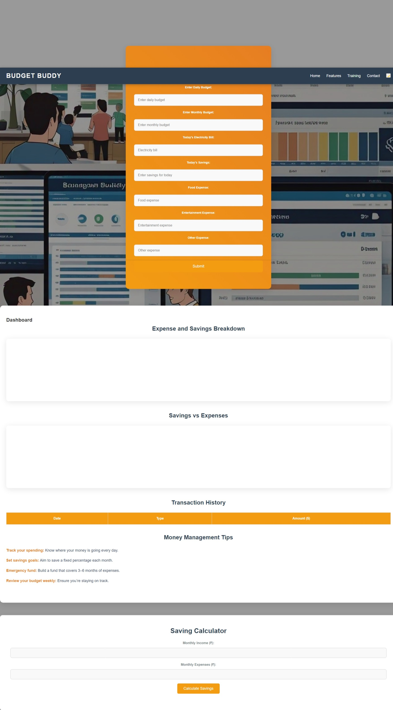
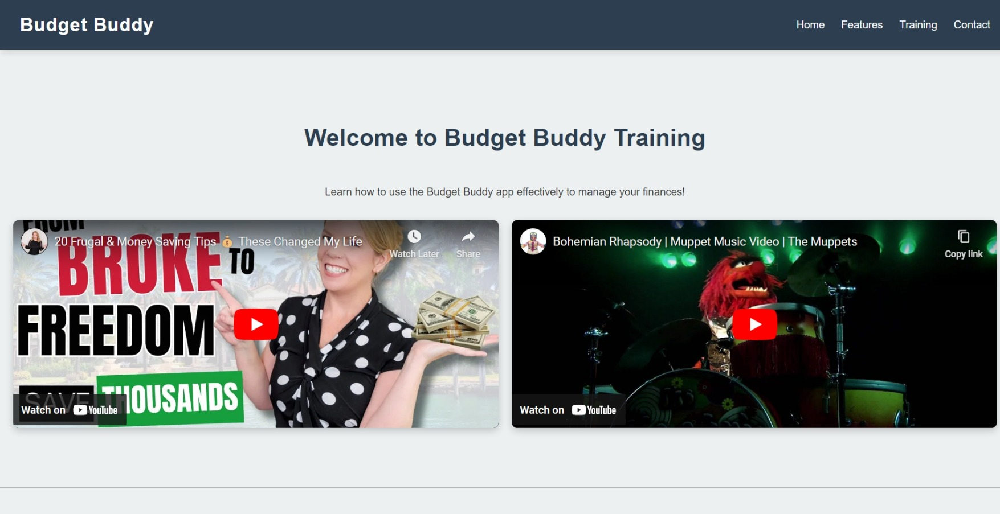

<div align="center">

# 🎯 BUDGET_BUDDY

### Your personal finance assistant — track expenses, plan budgets, and build better savings habits.

<p>
  <a href="https://parvathyamvk.github.io/BUDGET_BUDDY/">
    
  </a>
  <a href="https://drive.google.com/file/d/1H9t9QJs0CT35RVMxqAZudDF7mkINLSHS/view?usp=sharing">
    
  </a>
</p>

<p>
  
  
  
  
</p>

</div>

---

## 🌟 About the Project

**Budget Buddy** is a personal budgeting and savings website designed to help users understand and manage their everyday finances. It brings together budget inputs, expense calculations, savings calculations, transaction history, and chart-based summaries in one interface.

The project aims to make personal finance easier to approach by presenting spending information visually and offering simple savings guidance.

## ✨ Features

- 💰 **Budget tracking** – Enter daily and monthly budget amounts and expense details.
- 🧾 **Expense breakdown** – View spending across food, entertainment, and other expense categories.
- 📊 **Interactive charts** – Visualise expense breakdowns and compare monthly budget with current savings using Chart.js.
- 💸 **Savings calculator** – Calculate savings from income and expenses and view the savings percentage.
- 📒 **Transaction history** – Add a dated entry showing the saving or expense amount.
- 🔔 **Budget notification** – Display a notification when expenses exceed the entered daily budget.
- 🌙 **Dark mode** – Switch the page to a dark colour theme.
- 📱 **Responsive navigation** – Includes a mobile navigation menu.
- 📚 **Training and information pages** – Includes separate pages for features, training, and contact information.

## 🛠️ Built With

<p>
  
</p>

<p>
  
</p>

| Technology | Purpose |
|---|---|
| HTML5 | Page structure, forms, navigation, and content |
| CSS3 | Layout, styling, responsive navigation, and dark mode |
| JavaScript | Budget calculations, savings calculations, notifications, and interactions |
| Chart.js | Expense and budget comparison charts |

## 🚀 Getting Started

### Run Locally

1. Clone the repository:

   ```bash
   git clone https://github.com/parvathyamvk/BUDGET_BUDDY.git
   ```

2. Open the project folder:

   ```bash
   cd BUDGET_BUDDY
   ```

3. Open `index.html` in your web browser.

The charts use Chart.js from a CDN, so an internet connection is required for chart rendering.

## 📁 Project Structure

```text
BUDGET_BUDDY/
│
├── index.html          # Welcome / landing page
├── home.html           # Budget dashboard and savings calculator
├── features.html       # Overview of Budget Buddy features
├── training.html       # Training page
├── contact.html        # Contact and feedback page
├── style.css           # Main dashboard styles
├── styles.css          # Landing page styles
├── script.js           # Budget, chart, savings, and interaction logic
│
├── landing_page.jpeg   # Landing page screenshot
├── budget.jpeg         # Budget dashboard screenshot
├── Training.jpeg       # Training page screenshot
│
└── README.md           # Project documentation
```

## 📸 Screenshots

### 🏠 Landing Page



### 💰 Budget Dashboard



### 📚 Training Page



## 🎬 Project Demo

Watch the project demonstration:

[](https://drive.google.com/file/d/1H9t9QJs0CT35RVMxqAZudDF7mkINLSHS/view?usp=sharing)

## 🌐 Live Project

<div align="center">

[](https://parvathyamvk.github.io/BUDGET_BUDDY/)

[https://parvathyamvk.github.io/BUDGET_BUDDY/](https://parvathyamvk.github.io/BUDGET_BUDDY/)

</div>

## 👥 Team CodeUp

Developed by **CodeUp** at **College of Engineering Chengannur**.

| Team Member | Contribution |
|---|---|
| Parvathy A | Idea Generation |
| Jia Chinnu Abraham | Code Generation |
| Anjitha S | Code Generation |

## 🎯 Project Objective

Many people find it difficult to manage everyday spending, prepare budgets, and maintain savings. Budget Buddy aims to make these activities more approachable through a simple interface, expense summaries, visual charts, and savings calculations.

## 👩‍💻 Repository

[](https://github.com/parvathyamvk)

---

<div align="center">

**Made with ❤️ by Team CodeUp**

</div>
